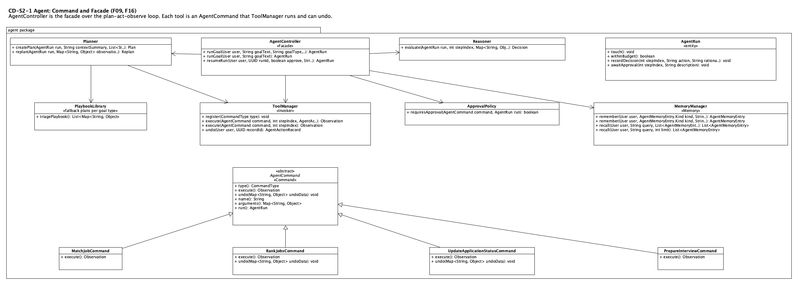
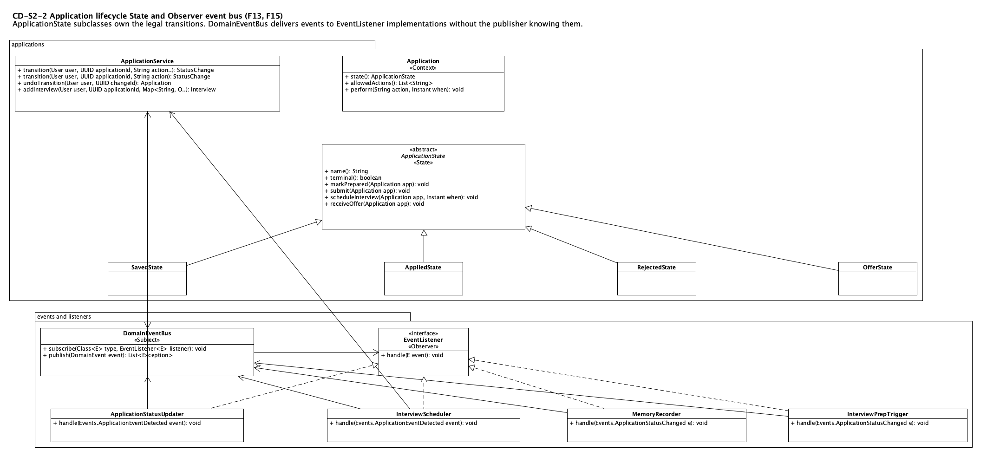
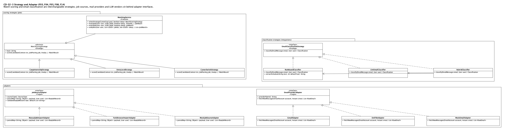
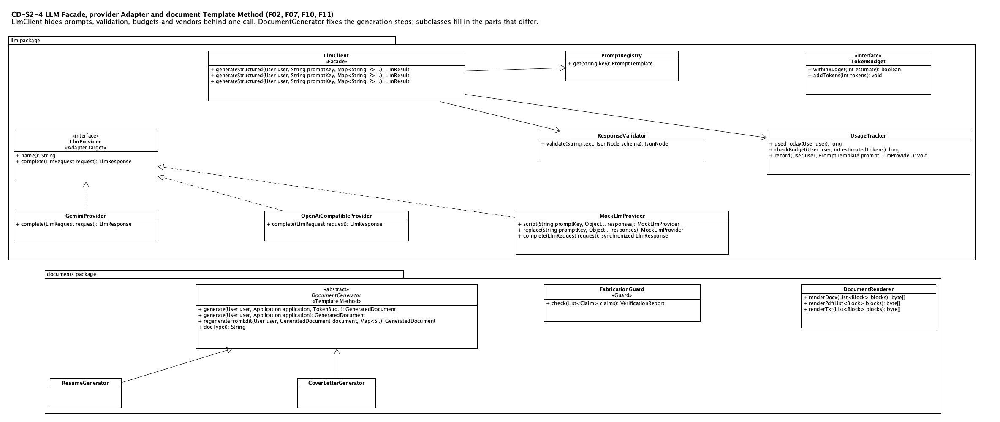
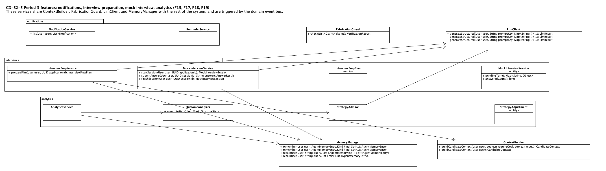

# CareerPilot: Stage 2 Implementation Report

| | |
|---|---|
| **Course** | EECS 3311 Software Design, Fall 2026 |
| **Repository** | <https://github.com/Parsa-Meshkini/CareerPilot> |
| **Team** | Parsa Meshkini |
| **Generated** | 2026-11-13 by tools/build_stage2_report.py |

# 1. Project overview and implementation status

CareerPilot is a desktop and command-line assistant for students looking for co-op, internship and entry-level jobs. It keeps a profile of facts the student has verified, imports postings (browser extension, paste, file), scores them against the student's goal, tracks each application through its lifecycle, reads job-related emails, and prepares tailored documents and interviews. An AI agent plans and runs multi-step goals ("prepare my application for the Acme posting") and asks before anything that changes data.

**AI/LLM integration.** One facade (`LlmClient`) calls Gemini (default, free tier) or any OpenAI-compatible endpoint through the `LlmProvider` adapter. Prompts are versioned JSON files in `careerpilot-core/src/main/resources/prompts`, answers are validated against a schema, token budgets are enforced per day and per run, and every feature has a deterministic fallback when the model is unavailable. The agent uses planning, tool use, memory and multi-step execution with approval.

**Working functionality.** All 19 Stage 1 features are implemented and reachable from the CLI and the JavaFX GUI; F04 also needs the Chrome extension and the REST server. The Java modules are `careerpilot-core`, `careerpilot-cli`, `careerpilot-gui`, `careerpilot-server` plus `extension/`. Automated tests: core 124, server 3, CLI 7, GUI 1, extension (node) tests.

**Honest limitations.**

- Gmail sign-in (F14) is verified only against a local stand-in for Google's endpoints. It has not been run with a real Google account, which needs the student's own OAuth client.
- On Nov 3 the default Gemini model answered HTTP 503 ("high demand") for every attempt, so the live end-to-end check was run through the OpenAI-compatible provider instead (Section 6.2). The Gemini provider itself was verified live in an earlier session.
- LinkedIn extraction exists but is switched off by default (FEATURE_LINKEDIN_EXTRACTION=false).
- The full deterministic test suite and KUMA agent validation belong to Stage 3.

# 2. Feature to implementation mapping

Every Stage 1 feature (F01-F19) is accounted for; there are no new features beyond Stage 1 and none were dropped. The feature table below is machine-checked against the source: each class listed exists and each method listed appears in those classes. Video links are in the demonstration index (Section 7).

## F01 Candidate profile and verified facts

| Field | Entry |
|---|---|
| Feature ID and name | F01 - Candidate profile and verified facts |
| Stage 1 reference | F01 |
| Status or change | Modified |
| Type | Deterministic |
| Implemented classes | `CandidateService`, `CandidateProfile`, `ProfileFact`, `FactType`, `FactSource`, `FactValidator` |
| Key methods | `updateProfile`, `addFact`, `verifyFacts`, `rejectFacts`, `completenessHints` |
| Design patterns | Repository (Spring Data) |
| Where to use it | GUI Profile page; CLI `profile show/set/fact-*` |
| Video link/timestamp | [https://drive.google.com/file/d/1NThfqULr6I2PLUaawXwYJkWKZ8aottcT/view?usp=sharing](https://drive.google.com/file/d/1NThfqULr6I2PLUaawXwYJkWKZ8aottcT/view?usp=sharing) |

**How the classes collaborate.** The view calls CandidateService, which validates the fact JSON with FactValidator against its FactType, stores it as an unverified ProfileFact, and only facts the student verifies are returned to the AI context. Stage 1 had one subclass per fact kind; one entity plus an enum with validated JSON replaced them.

## F02 Resume import and AI fact extraction

| Field | Entry |
|---|---|
| Feature ID and name | F02 - Resume import and AI fact extraction |
| Stage 1 reference | F02 |
| Status or change | Implemented |
| Type | Hybrid |
| Implemented classes | `CandidateService`, `ResumeParser`, `LlmClient`, `StorageService`, `TaskQueue`, `UploadedResume` |
| Key methods | `importResume`, `parseResume`, `extractText`, `extractFacts`, `generateStructured` |
| Design patterns | Facade (LlmClient); Adapter (LlmProvider) |
| Where to use it | GUI Profile > Import resume; CLI `profile resume FILE` |
| Video link/timestamp | [https://drive.google.com/file/d/1NThfqULr6I2PLUaawXwYJkWKZ8aottcT/view?usp=sharing](https://drive.google.com/file/d/1NThfqULr6I2PLUaawXwYJkWKZ8aottcT/view?usp=sharing) |

**How the classes collaborate.** importResume stores the file through StorageService and queues parseResume on TaskQueue. ResumeParser extracts text (PDFBox, POI or plain) and asks LlmClient for facts, which are saved unverified for the student to review.

## F03 Career goal and strategy configuration

| Field | Entry |
|---|---|
| Feature ID and name | F03 - Career goal and strategy configuration |
| Stage 1 reference | F03 |
| Status or change | Implemented |
| Type | Deterministic |
| Implemented classes | `CandidateService`, `CareerGoal`, `GoalType`, `StrategyWeights`, `MatchingService` |
| Key methods | `updateCareerGoal`, `selectStrategy` |
| Design patterns | Strategy |
| Where to use it | GUI Profile > Goal; CLI `profile goal-set/goal-show` |
| Video link/timestamp | [https://drive.google.com/file/d/1NThfqULr6I2PLUaawXwYJkWKZ8aottcT/view?usp=sharing](https://drive.google.com/file/d/1NThfqULr6I2PLUaawXwYJkWKZ8aottcT/view?usp=sharing) |

**How the classes collaborate.** The goal type chosen by the student selects which MatchScoringStrategy MatchingService uses and seeds the StrategyWeights that F19 later adjusts.

## F04 Browser-extension batch job import

| Field | Entry |
|---|---|
| Feature ID and name | F04 - Browser-extension batch job import |
| Stage 1 reference | F04 |
| Status or change | Implemented |
| Type | Deterministic |
| Implemented classes | `ApiController`, `TokenAuthInterceptor`, `JobImportService`, `JobSourceRegistry`, `YorkBrowserImportAdapter`, `ImportBatch`, `TaskQueue` |
| Key methods | `createBatch`, `processBatch`, `parse` |
| Design patterns | Adapter; Observer (JobsImported) |
| Where to use it | Chrome extension (extension/content, popup, api); REST `/api/import`; CLI `jobs import-york` |
| Video link/timestamp | [https://drive.google.com/file/d/1NThfqULr6I2PLUaawXwYJkWKZ8aottcT/view?usp=sharing](https://drive.google.com/file/d/1NThfqULr6I2PLUaawXwYJkWKZ8aottcT/view?usp=sharing) |

**How the classes collaborate.** The content script reads the postings on the page, the service worker posts them to ApiController with the student's token, JobImportService creates an ImportBatch and processes it in the background through the York adapter, then publishes JobsImported which triggers F09.

## F05 Manual job import (paste or file)

| Field | Entry |
|---|---|
| Feature ID and name | F05 - Manual job import (paste or file) |
| Stage 1 reference | F05 |
| Status or change | Implemented |
| Type | Hybrid |
| Implemented classes | `JobImportService`, `ManualJobImportAdapter`, `MockJobSourceAdapter`, `LlmClient` |
| Key methods | `importManual`, `importRecord`, `parse`, `structure_paste` |
| Design patterns | Adapter; Facade |
| Where to use it | GUI Jobs > Import; CLI `jobs import-paste/import-file` |
| Video link/timestamp | [https://drive.google.com/file/d/1NThfqULr6I2PLUaawXwYJkWKZ8aottcT/view?usp=sharing](https://drive.google.com/file/d/1NThfqULr6I2PLUaawXwYJkWKZ8aottcT/view?usp=sharing) |

**How the classes collaborate.** Pasted text goes to LlmClient (job.structure_paste prompt) to extract title, company and description; CSV or JSON files are read by the adapters directly. Both end in JobImportService.importRecord.

## F06 Job normalization and duplicate detection

| Field | Entry |
|---|---|
| Feature ID and name | F06 - Job normalization and duplicate detection |
| Stage 1 reference | F06 |
| Status or change | Implemented |
| Type | Deterministic |
| Implemented classes | `JobNormalizer`, `DuplicateDetector`, `JobPosting`, `JobPostingRepository`, `ImportBatch` |
| Key methods | `normalize`, `findDuplicate` |
| Design patterns | Repository |
| Where to use it | Runs inside every import |
| Video link/timestamp | [https://drive.google.com/file/d/1NThfqULr6I2PLUaawXwYJkWKZ8aottcT/view?usp=sharing](https://drive.google.com/file/d/1NThfqULr6I2PLUaawXwYJkWKZ8aottcT/view?usp=sharing) |

**How the classes collaborate.** importRecord calls JobNormalizer.normalize (clean text, deadline, work model, fingerprint) then DuplicateDetector.findDuplicate; a duplicate is merged and counted in the batch instead of saved again.

## F07 AI job description analysis

| Field | Entry |
|---|---|
| Feature ID and name | F07 - AI job description analysis |
| Stage 1 reference | F07 |
| Status or change | Implemented |
| Type | AI |
| Implemented classes | `JobAnalysisService`, `JobAnalysis`, `LlmClient`, `LlmProvider`, `PromptRegistry`, `ResponseValidator`, `UsageTracker` |
| Key methods | `analyzeJob`, `generateStructured`, `validate`, `fallbackKeywordAnalysis` |
| Design patterns | Facade; Adapter |
| Where to use it | GUI Jobs detail; CLI `jobs analyze` |
| Video link/timestamp | [https://drive.google.com/file/d/1NThfqULr6I2PLUaawXwYJkWKZ8aottcT/view?usp=sharing](https://drive.google.com/file/d/1NThfqULr6I2PLUaawXwYJkWKZ8aottcT/view?usp=sharing) |

**How the classes collaborate.** analyzeJob sends the posting through LlmClient, which loads the versioned prompt, checks the token budget, calls the provider, validates the JSON against the schema, retries transient and schema failures with backoff, and records usage. If the model is down a keyword analysis is used and the result is marked as such.

## F08 Candidate-job matching and skill-gap analysis

| Field | Entry |
|---|---|
| Feature ID and name | F08 - Candidate-job matching and skill-gap analysis |
| Stage 1 reference | F08 |
| Status or change | Implemented |
| Type | Hybrid |
| Implemented classes | `MatchingService`, `ContextBuilder`, `MatchScoringStrategy`, `CoopInternshipStrategy`, `EntryLevelStrategy`, `CareerSwitchStrategy`, `JobMatch` |
| Key methods | `matchJob`, `selectStrategy`, `score`, `rankJobs`, `buildCandidateContext` |
| Design patterns | Strategy |
| Where to use it | GUI Jobs (bearing ring, detail); CLI `jobs match/score/show` |
| Video link/timestamp | [https://drive.google.com/file/d/1NThfqULr6I2PLUaawXwYJkWKZ8aottcT/view?usp=sharing](https://drive.google.com/file/d/1NThfqULr6I2PLUaawXwYJkWKZ8aottcT/view?usp=sharing) |

**How the classes collaborate.** ContextBuilder gathers verified facts and the goal; MatchingService picks the strategy for the goal type and scores deterministically (quick or deep with the analysis); the AI only writes the explanation and transferable-skill hints, never the score.

## F09 Agent batch triage and shortlist

| Field | Entry |
|---|---|
| Feature ID and name | F09 - Agent batch triage and shortlist |
| Stage 1 reference | F09 |
| Status or change | Implemented |
| Type | AI (agent) |
| Implemented classes | `TriageTrigger`, `AgentController`, `Planner`, `PlaybookLibrary`, `Reasoner`, `ToolManager`, `AgentCommand`, `QuickScoreJobsCommand`, `SelectForDeepAnalysisCommand`, `DeepMatchJobsCommand`, `RankJobsCommand`, `MemoryManager`, `AgentRun` |
| Key methods | `handle`, `startTriage`, `runGoal`, `createPlan`, `execute`, `evaluate`, `remember` |
| Design patterns | Command; Observer; Facade |
| Where to use it | Automatic after an import; GUI Agent page; CLI `agent runs/show` |
| Video link/timestamp | [https://drive.google.com/file/d/1NThfqULr6I2PLUaawXwYJkWKZ8aottcT/view?usp=sharing](https://drive.google.com/file/d/1NThfqULr6I2PLUaawXwYJkWKZ8aottcT/view?usp=sharing) |

**How the classes collaborate.** TriageTrigger listens for JobsImported and starts a run through AgentController. The plan (hand-written playbook, or the LLM's plan when valid) is executed one AgentCommand at a time by ToolManager; after each step Reasoner decides to continue, replan or stop, and every action is recorded in AgentActionRecord.

## F10 Tailored resume with fabrication guard

| Field | Entry |
|---|---|
| Feature ID and name | F10 - Tailored resume with fabrication guard |
| Stage 1 reference | F10 |
| Status or change | Implemented |
| Type | Hybrid |
| Implemented classes | `DocumentGenerator`, `ResumeGenerator`, `FabricationGuard`, `DocumentRenderer`, `DocumentService`, `GeneratedDocument` |
| Key methods | `generate`, `check`, `renderDocx`, `renderPdf`, `regenerateFromEdit` |
| Design patterns | Template Method; Facade |
| Where to use it | GUI Tracker > Documents; CLI `docs resume` |
| Video link/timestamp | [https://drive.google.com/file/d/1NThfqULr6I2PLUaawXwYJkWKZ8aottcT/view?usp=sharing](https://drive.google.com/file/d/1NThfqULr6I2PLUaawXwYJkWKZ8aottcT/view?usp=sharing) |

**How the classes collaborate.** DocumentService calls the generator's final generate(): build context, ask the LLM, run FabricationGuard.check on every claim against verified facts, remove violating claims, then render. Subclasses only supply the prompt variables, claim extraction and block layout.

## F11 Tailored cover letter

| Field | Entry |
|---|---|
| Feature ID and name | F11 - Tailored cover letter |
| Stage 1 reference | F11 |
| Status or change | Implemented |
| Type | Hybrid |
| Implemented classes | `DocumentGenerator`, `CoverLetterGenerator`, `FabricationGuard`, `DocumentRenderer` |
| Key methods | `generate`, `check` |
| Design patterns | Template Method; Facade |
| Where to use it | GUI Tracker > Documents; CLI `docs cover-letter` |
| Video link/timestamp | [https://drive.google.com/file/d/1NThfqULr6I2PLUaawXwYJkWKZ8aottcT/view?usp=sharing](https://drive.google.com/file/d/1NThfqULr6I2PLUaawXwYJkWKZ8aottcT/view?usp=sharing) |

**How the classes collaborate.** Same template as F10 with a different prompt, claim extractor and layout.

## F12 Application package builder and ZIP export

| Field | Entry |
|---|---|
| Feature ID and name | F12 - Application package builder and ZIP export |
| Stage 1 reference | F12 |
| Status or change | Implemented |
| Type | Deterministic |
| Implemented classes | `PackageAssembler`, `ApplicationPackage`, `BuildPackageCommand`, `DocumentService`, `StorageService` |
| Key methods | `buildPackage`, `download` |
| Design patterns | Command; Template Method (uses) |
| Where to use it | GUI Tracker > Build package; CLI `docs package/download` |
| Video link/timestamp | [https://drive.google.com/file/d/1NThfqULr6I2PLUaawXwYJkWKZ8aottcT/view?usp=sharing](https://drive.google.com/file/d/1NThfqULr6I2PLUaawXwYJkWKZ8aottcT/view?usp=sharing) |

**How the classes collaborate.** PackageAssembler generates any missing documents, adds the job description and a checklist, zips them through StorageService and records an ApplicationPackage; the agent reaches it through BuildPackageCommand.

## F13 Application lifecycle tracking and undo

| Field | Entry |
|---|---|
| Feature ID and name | F13 - Application lifecycle tracking and undo |
| Stage 1 reference | F13 |
| Status or change | Implemented |
| Type | Deterministic |
| Implemented classes | `ApplicationService`, `Application`, `ApplicationState`, `SavedState`, `PreparedState`, `AppliedState`, `InterviewState`, `OfferState`, `RejectedState`, `StatusChange` |
| Key methods | `createApplication`, `transition`, `undoTransition` |
| Design patterns | State; Observer |
| Where to use it | GUI Tracker board; CLI `apps create/act/undo` |
| Video link/timestamp | [https://drive.google.com/file/d/1NThfqULr6I2PLUaawXwYJkWKZ8aottcT/view?usp=sharing](https://drive.google.com/file/d/1NThfqULr6I2PLUaawXwYJkWKZ8aottcT/view?usp=sharing) |

**How the classes collaborate.** transition asks the current ApplicationState object whether the action is legal and for the next state, saves a StatusChange (which makes undo possible), and publishes ApplicationStatusChanged.

## F14 Email monitoring and application event detection

| Field | Entry |
|---|---|
| Feature ID and name | F14 - Email monitoring and application event detection |
| Stage 1 reference | F14 |
| Status or change | Implemented (Gmail verified only against a local test double) |
| Type | Hybrid |
| Implemented classes | `EmailSyncService`, `EmailProviderRegistry`, `GmailAdapter`, `GmailConnector`, `CredentialVault`, `EmlFileAdapter`, `MockEmailAdapter`, `EmailNormalizer`, `EmailEventDetector`, `HybridClassifier`, `RuleBasedClassifier`, `LlmEmailClassifier`, `ApplicationMatcher`, `DetectedEmailEvent` |
| Key methods | `syncAccount`, `importEmlFiles`, `detect`, `classify`, `match`, `confirmEvent`, `fetchNewMessages`, `connect` |
| Design patterns | Adapter; Strategy |
| Where to use it | GUI Email page; CLI `email upload/sync-mock/connect-gmail/events/confirm` |
| Video link/timestamp | [https://drive.google.com/file/d/1NThfqULr6I2PLUaawXwYJkWKZ8aottcT/view?usp=sharing](https://drive.google.com/file/d/1NThfqULr6I2PLUaawXwYJkWKZ8aottcT/view?usp=sharing) |

**How the classes collaborate.** A provider adapter returns RawEmails; EmailNormalizer cleans them; EmailEventDetector runs the HybridClassifier (rules first, LLM when rules are unsure); ApplicationMatcher links the email to an application; a confident match is published as an event and the rest wait for the student to confirm.

## F15 Event-driven updates, reminders and notifications

| Field | Entry |
|---|---|
| Feature ID and name | F15 - Event-driven updates, reminders and notifications |
| Stage 1 reference | F15 |
| Status or change | Implemented |
| Type | Deterministic |
| Implemented classes | `DomainEventBus`, `EventListener`, `ApplicationStatusUpdater`, `InterviewScheduler`, `MemoryRecorder`, `NotificationService`, `ReminderService`, `Notification` |
| Key methods | `publish`, `subscribe`, `checkDeadlines`, `add`, `markAllRead` |
| Design patterns | Observer; State; Command (undo) |
| Where to use it | GUI Dashboard feed; CLI `notifications`, `remind` |
| Video link/timestamp | [https://drive.google.com/file/d/1NThfqULr6I2PLUaawXwYJkWKZ8aottcT/view?usp=sharing](https://drive.google.com/file/d/1NThfqULr6I2PLUaawXwYJkWKZ8aottcT/view?usp=sharing) |

**How the classes collaborate.** Detected email events are published on DomainEventBus; ApplicationStatusUpdater moves the application, InterviewScheduler records the interview, MemoryRecorder saves what happened for the agent, and NotificationService stores a de-duplicated notification. ReminderService raises deadline notifications.

## F16 Goal-driven agent workspace

| Field | Entry |
|---|---|
| Feature ID and name | F16 - Goal-driven agent workspace |
| Stage 1 reference | F16 |
| Status or change | Implemented |
| Type | AI (agent) |
| Implemented classes | `AgentController`, `Planner`, `PlaybookLibrary`, `Reasoner`, `ToolManager`, `ApprovalPolicy`, `AgentCommand`, `UpdateApplicationStatusCommand`, `MemoryManager`, `ContextBuilder`, `AgentRun`, `AgentActionRecord` |
| Key methods | `runGoal`, `resumeRun`, `createPlan`, `requiresApproval`, `execute`, `undo`, `recall` |
| Design patterns | Command; Facade |
| Where to use it | GUI Agent page; CLI `agent run/approve/reject/undo/memory` |
| Video link/timestamp | [https://drive.google.com/file/d/1NThfqULr6I2PLUaawXwYJkWKZ8aottcT/view?usp=sharing](https://drive.google.com/file/d/1NThfqULr6I2PLUaawXwYJkWKZ8aottcT/view?usp=sharing) |

**How the classes collaborate.** A goal in plain words becomes a typed run; steps with side effects stop at ApprovalPolicy until the student approves, rejects (the agent replans and remembers the preference) or undoes; MemoryManager recalls preferences into later plans.

## F17 Interview preparation plan

| Field | Entry |
|---|---|
| Feature ID and name | F17 - Interview preparation plan |
| Stage 1 reference | F17 |
| Status or change | Implemented |
| Type | AI |
| Implemented classes | `InterviewPrepService`, `InterviewPrepPlan`, `InterviewPrepTrigger`, `ContextBuilder`, `FabricationGuard`, `LlmClient`, `PrepareInterviewCommand` |
| Key methods | `preparePlan`, `latest`, `check` |
| Design patterns | Facade; Observer (auto-trigger) |
| Where to use it | GUI Interview page; CLI `interview prepare/show`; agent tool prepare_interview |
| Video link/timestamp | [https://drive.google.com/file/d/1NThfqULr6I2PLUaawXwYJkWKZ8aottcT/view?usp=sharing](https://drive.google.com/file/d/1NThfqULr6I2PLUaawXwYJkWKZ8aottcT/view?usp=sharing) |

**How the classes collaborate.** InterviewPrepTrigger reacts to an interview status change; InterviewPrepService builds the context, asks the LLM for questions and STAR stories, and FabricationGuard rejects stories that use facts the student has not verified; a deterministic plan is used when the model fails.

## F18 AI mock interview and feedback

| Field | Entry |
|---|---|
| Feature ID and name | F18 - AI mock interview and feedback |
| Stage 1 reference | F18 |
| Status or change | Implemented |
| Type | AI |
| Implemented classes | `MockInterviewService`, `MockInterviewSession`, `LlmClient`, `MemoryManager` |
| Key methods | `startSession`, `submitAnswer`, `finishSession`, `abandon` |
| Design patterns | Facade |
| Where to use it | GUI Interview page; CLI `interview mock/answer/finish` |
| Video link/timestamp | [https://drive.google.com/file/d/1NThfqULr6I2PLUaawXwYJkWKZ8aottcT/view?usp=sharing](https://drive.google.com/file/d/1NThfqULr6I2PLUaawXwYJkWKZ8aottcT/view?usp=sharing) |

**How the classes collaborate.** startSession asks for a first question; each submitAnswer is scored against a rubric by the LLM and the next question depends on the weak areas so far; finishSession writes a summary and stores feedback in agent memory. Sessions can be resumed.

## F19 Outcome analytics and adaptive strategy

| Field | Entry |
|---|---|
| Feature ID and name | F19 - Outcome analytics and adaptive strategy |
| Stage 1 reference | F19 |
| Status or change | Implemented |
| Type | Hybrid |
| Implemented classes | `AnalyticsService`, `OutcomeAnalyzer`, `StrategyAdvisor`, `StrategyAdjustment`, `StrategyWeights`, `MemoryManager` |
| Key methods | `getInsights`, `computeStats`, `proposeAdjustments`, `accept`, `reject`, `revert` |
| Design patterns | Strategy; Observer (MemoryRecorder feeds data) |
| Where to use it | GUI Insights page; CLI `analytics` |
| Video link/timestamp | [https://drive.google.com/file/d/1NThfqULr6I2PLUaawXwYJkWKZ8aottcT/view?usp=sharing](https://drive.google.com/file/d/1NThfqULr6I2PLUaawXwYJkWKZ8aottcT/view?usp=sharing) |

**How the classes collaborate.** OutcomeAnalyzer computes response and interview rates by score band, source and role; StrategyAdvisor proposes bounded weight changes only with enough evidence; the LLM writes the explanation; nothing changes until the student accepts, and accepted changes can be reverted.

# 3. Implemented design patterns

Seven distinct patterns are implemented. Class diagrams generated from the code (UMLet sources in `docs/stage2/uml/src`) follow the table.

## 3.1 Facade

- **Problem addressed.** Callers should not know about prompts, schemas, budgets, retries or vendors, nor about the plan-act-observe loop.
- **Participants.** LlmClient (facade) over PromptRegistry, ResponseValidator, TokenBudget, UsageTracker, LlmProviderFactory; AgentController (facade) over Planner, ToolManager, Reasoner, ApprovalPolicy, MemoryManager.
- **Source files and methods.** llm/LlmClient.java generateStructured; agent/AgentController.java runGoal, resumeRun
- **How it follows the pattern and why it helps.** Every AI feature calls one method and gets validated JSON or a typed error; the agent is started with one call. Matches Stage 1.

## 3.2 Adapter

- **Problem addressed.** Job sources, mailboxes and LLM vendors all differ in format and protocol but the rest of the system needs one shape.
- **Participants.** JobSourceAdapter with ManualJobImportAdapter, YorkBrowserImportAdapter, MockJobSourceAdapter; EmailProviderAdapter with GmailAdapter, EmlFileAdapter, MockEmailAdapter; LlmProvider with GeminiProvider, OpenAiCompatibleProvider, MockLlmProvider.
- **Source files and methods.** jobs/JobSourceAdapter.java parse; integrations/EmailProviderAdapter.java fetchNewMessages; llm/LlmProvider.java complete
- **How it follows the pattern and why it helps.** New sources are added by writing one class; GmailAdapter was added in Period 3 without touching the pipeline after the fetch. Differs from Stage 1 only in names (OpenAIProvider became OpenAiCompatibleProvider so Groq and OpenRouter work too).

## 3.3 Strategy

- **Problem addressed.** Scoring and classification rules differ by situation and must be swappable at run time.
- **Participants.** MatchScoringStrategy with CoopInternshipStrategy, EntryLevelStrategy, CareerSwitchStrategy chosen by MatchingService.selectStrategy; EmailClassificationStrategy with RuleBasedClassifier, LlmEmailClassifier, HybridClassifier held by EmailEventDetector.setStrategy.
- **Source files and methods.** jobs/MatchingService.java selectStrategy; integrations/EmailEventDetector.java detect, setStrategy
- **How it follows the pattern and why it helps.** The student's goal changes how jobs are scored without any if/else in the service; the email detector can run rules only, LLM only, or hybrid. Matches Stage 1.

## 3.4 Command

- **Problem addressed.** Every agent tool must be runnable, loggable, approvable and, where possible, undoable in the same way.
- **Participants.** AgentCommand (command) with MatchJobCommand, RankJobsCommand, UpdateApplicationStatusCommand, BuildPackageCommand, PrepareInterviewCommand and others; ToolManager (invoker); AgentActionRecord (history for undo).
- **Source files and methods.** agent/AgentCommand.java execute, undo; agent/ToolManager.java execute, undo
- **How it follows the pattern and why it helps.** The planner only names tools; ToolManager runs them uniformly, records each action and can undo reversible ones. Matches Stage 1.

## 3.5 State

- **Problem addressed.** Which actions are legal depends on where the application is in its lifecycle, and the rules must not be scattered across services.
- **Participants.** ApplicationState (abstract state) with SavedState, PreparedState, AppliedState, InterviewState, OfferState, AcceptedState, RejectedState, DeclinedState, WithdrawnState; Application (context).
- **Source files and methods.** applications/ApplicationState.java; applications/ApplicationService.java transition, undoTransition
- **How it follows the pattern and why it helps.** An illegal transition raises InvalidTransitionException from the state object itself. Matches Stage 1.

## 3.6 Observer

- **Problem addressed.** Importing, emailing and status changes must trigger reminders, memory, triage and interview prep without the publisher knowing the receivers.
- **Participants.** DomainEventBus (subject), EventListener (observer), listeners TriageTrigger, ApplicationStatusUpdater, InterviewScheduler, MemoryRecorder, InterviewPrepTrigger; events in Events.
- **Source files and methods.** events/DomainEventBus.java publish, subscribe; notifications/*.java handle
- **How it follows the pattern and why it helps.** A listener failure is collected and logged and never breaks the publisher or other listeners. Matches Stage 1.

## 3.7 Template Method

- **Problem addressed.** Resume and cover letter generation share the same safety-critical steps and must not be able to skip the fabrication check.
- **Participants.** DocumentGenerator (final generate defines the steps; abstract promptKey, buildPromptVariables, claims, removeClaims, render) with ResumeGenerator and CoverLetterGenerator.
- **Source files and methods.** documents/DocumentGenerator.java generate; ResumeGenerator.java; CoverLetterGenerator.java
- **How it follows the pattern and why it helps.** generate is final, so FabricationGuard.check always runs. Matches Stage 1.

## 3.8 Updated UML class diagrams

The Stage 1 class diagrams (`docs/uml`) described the design; the diagrams below are generated from the implemented Java classes by `tools/gen_stage2_uml.py`, so every box, signature and arrow exists in the code. The Stage 1 use-case and sequence diagrams are still accurate in behaviour; the only visible differences are the class names listed in Section 4 (for example LLMClient is LlmClient, GmailAdapter and CredentialVault are in the integrations package) and that UI classes are JavaFX views instead of web pages.

# 4. Changes and rationale

| Original design | Implemented change | Reason | Impact |
|---|---|---|---|
| Python/Django REST backend, Celery and Redis | Java 17 and Spring Boot 3.3, in-process TaskQueue | The course requires Java for Stage 2; a single process removes the need to run a broker for a desktop tool. | All classes keep their Stage 1 names in Java camelCase; background work is a TaskQueue instead of Celery tasks. |
| React single-page app | JavaFX GUI with AtlantaFX theme | Java requirement; a desktop client also keeps the data on the student's computer. | GUI pages call core services in-process (no REST hop); REST remains only for the Chrome extension (F04). |
| Typer CLI | picocli CLI (`bin/careerpilot`) | Java requirement. | Same commands, one subcommand class per feature group. |
| PostgreSQL | H2 by default, any JDBC URL through DATABASE_URL | Zero-setup for graders; PostgreSQL still works. | Entities use JPA with generated UUIDs. |
| MinIO/S3 object storage and signed URLs | Local StorageService under ~/.careerpilot | No cloud dependency for a single-user tool. | Signed URLs became direct service calls (DocumentService.file, PackageAssembler.download). |
| ProfileFact subclass per kind | One ProfileFact entity with a FactType enum and validated JSON | Less code and a single table, validation still per type (FactValidator). | F01, F02, F10, F17 read facts through the same class. |
| OpenAIProvider | OpenAiCompatibleProvider and GeminiProvider; default model is Gemini through REST | A free-tier model works for development; any OpenAI-style endpoint (Groq, OpenRouter) is supported with a base URL. | LlmProvider adapter pattern unchanged. |
| reportlab / python-docx | Apache PDFBox / POI in DocumentRenderer | Java equivalents. | F10-F12 output the same formats (PDF, DOCX, TXT). |
| Gmail adapter planned as Tier 2 | GmailAdapter, GmailConnector (browser consent on a loopback port, read-only scope), CredentialVault (AES-GCM) | Implemented in Period 3. Refresh tokens are encrypted at rest and no password is ever typed into CareerPilot. | F14 gains a third provider. Tested against a local stand-in for Google; not yet exercised against a live Google account. |
| CredentialVault.encrypt() in the Stage 1 class list | CredentialVault.put/get with AES-256-GCM, key file with owner-only permissions | Same responsibility, simpler API. | Used only by GmailAdapter. |
| First JavaFX version with plain tables | Redesign branch: tokens, sidebar groups, command palette, pipeline board, bearing ring | Usability audit with before and after screenshots in docs/gui-redesign. | No feature change; see docs/gui-redesign/CHANGES.md. |
| New: Docker image for the REST server | Dockerfile and docker-compose.server.yml | Lets the extension talk to a server on another machine. | Not a graded feature. |

No pattern from Stage 1 was dropped or replaced, so no pattern needed a replacement justification.

# 5. AI tools and collaboration log

| Tool or platform | Model | Used for | Tokens and cost |
|---|---|---|---|
| Claude Code (CLI) | Claude Sonnet 5.5 | Implementation of core services, CLI, GUI, tests, UMLet generation, this report, final audit | 113.7M tokens in 442 calls (0.9K uncached input, 0.75M output, 2.30M cache writes, 110.7M cache reads); about USD 24.29 |
| Claude Code (CLI) | Claude Opus 5.5 | Design and harder implementation work in earlier sessions | 34.3M tokens in 171 calls (0.4K uncached input, 0.31M output, 1.41M cache writes, 32.6M cache reads); about USD 19.70 |
| Gemini API (runtime, not development) | Gemini default model | The product's own LLM calls during early end-to-end checks | 12 calls logged with 0 tokens (the free-tier quota ran out and the model answered HTTP 503); no charge |
| OpenAI-compatible API (runtime, not development) | gpt-6-luna | The product's own LLM calls during the Nov 3 to Nov 6 live end-to-end checks | 14 calls, 21,558 input and 9,231 output tokens (30,789 total); cost not computed because no price list for this model was available, see the billing page of that account |

**How the numbers were obtained.** The Claude Code rows are summed from the local Claude Code session transcripts for this project (every distinct API response, duplicates removed) and priced at the list rates in the local cost tracker: Sonnet 5.5 USD 2 / 10 / 2.50 / 0.10 and Opus 5.5 USD 4 / 20 / 5 / 0.20 per million input / output / cache-write / cache-read tokens. Total development cost is about USD 43.99 (147.9M tokens). These are estimates from list prices, not invoice figures, and they cover only the transcripts still stored on the author's machine. The runtime rows are read from the `LlmUsageRecord` table of the application's own database (`careerpilot llm-check` shows the same records).

**Representative interactions.**

1. *Resume import.* Prompt: implement F02 with ResumeParser and a schema-validated extraction. Result: ResumeParser plus the `resume.extract_facts` prompt. Reviewed by hand; extraction output is saved as unverified so a wrong guess cannot reach a document.
2. *Fabrication guard.* Prompt: generated documents must not state anything the student has not verified. Result: FabricationGuard.check on every claim and a final `generate()` that cannot skip it. Verified with tests that insert an invented employer.
3. *Gmail.* Prompt: add a Gmail provider without storing a password. Result: loopback OAuth, read-only scope, AES-GCM vault. Reviewed: the test double caught a status bug (an expired grant must mark the account for reconnect) and an old test that assumed GMAIL was unavailable.
4. *Class diagrams.* Prompt: update the UML to the implemented classes. Result: a generator that reads signatures from the code. A label calling PlaybookLibrary a Strategy was corrected because it is a library of fallback plans.

# 6. Development and verification summary

## 6.1 Weekly commit summary

Only commits that change code, tests or build files count as code commits; documentation and screenshot-only commits are listed but not counted.

### Period 1 (Oct 20-26): 12 code commits (19 commits in total)

| Commit | Date | Message | Changes code |
|---|---|---|---|
| [fc0fbeb](https://github.com/Parsa-Meshkini/CareerPilot/commit/fc0fbebc09c7859064abb6ac9b8bc68614523048) | 2026-10-23 | Backend skeleton: Django project, token auth, tenant-scoped repository, task queue | yes |
| [972ef6e](https://github.com/Parsa-Meshkini/CareerPilot/commit/972ef6e8e6bab9889259d3c7ad9d7d3b5ee51864) | 2026-10-24 | LLM subsystem: LLMClient facade with Gemini, OpenAI-compatible and mock provider adapters | yes |
| [68e0cf2](https://github.com/Parsa-Meshkini/CareerPilot/commit/68e0cf2bcfadc4aea2d41d72c1c2387c67254c9c) | 2026-10-24 | F01/F03: candidate profile, verified facts and career goal with strategy weights | no (docs/assets) |
| [1abc24e](https://github.com/Parsa-Meshkini/CareerPilot/commit/1abc24e4e60eee91ca48440952c57601e14c547d) | 2026-10-24 | F02: resume import with PDF/DOCX text extraction and AI fact extraction | yes |
| [7cc81fd](https://github.com/Parsa-Meshkini/CareerPilot/commit/7cc81fd2c00d91ca84263ef7d68fd836c1cba462) | 2026-10-24 | F04-F06: job import pipeline with source adapters, normalization and duplicate detection | yes |
| [87fd4f1](https://github.com/Parsa-Meshkini/CareerPilot/commit/87fd4f16db524551ff736298b7cbf878cf64fd93) | 2026-10-24 | F07/F08: AI job analysis and strategy-based candidate-job matching | yes |
| [73b539b](https://github.com/Parsa-Meshkini/CareerPilot/commit/73b539b741a69c0b4b6a2a0059072f8a4320e867) | 2026-10-24 | F13: application lifecycle with State pattern, timeline, undo and status events | no (docs/assets) |
| [25ea97e](https://github.com/Parsa-Meshkini/CareerPilot/commit/25ea97e21365f3955bf7dd161a1c3cb5ddd6eb29) | 2026-10-25 | F10: tailored resume generation with FabricationGuard and Template Method pipeline | yes |
| [6ed218b](https://github.com/Parsa-Meshkini/CareerPilot/commit/6ed218bd0f2fbc2db31fa92c89a0a9d7c73dace2) | 2026-10-25 | F11: tailored cover letter generation on the shared document template | yes |
| [8f79ec0](https://github.com/Parsa-Meshkini/CareerPilot/commit/8f79ec0af8717a0ae815b736f1a744b7a4c70796) | 2026-10-25 | F12: application package builder with ZIP export | no (docs/assets) |
| [26f14d8](https://github.com/Parsa-Meshkini/CareerPilot/commit/26f14d87930c2125674391dcbc16a23788b8e9c7) | 2026-10-25 | Agent tools: Command-pattern tool catalog, ToolManager invoker, approval policy and memory | no (docs/assets) |
| [7522094](https://github.com/Parsa-Meshkini/CareerPilot/commit/752209496ef7ad2cbf3838c1b6ae0fa18a0d4c20) | 2026-10-25 | F16: goal-driven agent with planning, approvals, reasoning, replanning and memory | yes |
| [b4f4e38](https://github.com/Parsa-Meshkini/CareerPilot/commit/b4f4e389daad1255f69ae7dea5d8d31a64456387) | 2026-10-25 | F09: automatic agent batch triage with budget-aware deep analysis and shortlist | no (docs/assets) |
| [97e885f](https://github.com/Parsa-Meshkini/CareerPilot/commit/97e885f05b77bb56f23f988e5d87f0b8ba6c5768) | 2026-10-25 | GUI: React + Vite app shell, sign-in and Profile page (F01-F03) | yes |
| [84731d7](https://github.com/Parsa-Meshkini/CareerPilot/commit/84731d7ff2e4927fa7f07caa74bf20a42f28a418) | 2026-10-25 | GUI: Jobs and Job detail pages (F04-F09 views) | yes |
| [738329c](https://github.com/Parsa-Meshkini/CareerPilot/commit/738329cd790cedd8eb2a55abbb585f547af16634) | 2026-10-25 | GUI: application tracker with lifecycle actions, documents and package download (F10-F13) | yes |
| [198866f](https://github.com/Parsa-Meshkini/CareerPilot/commit/198866fb8a6fe5109a261dfdb4bfb19761309cb2) | 2026-10-25 | GUI: agent workspace and dashboard (F09, F16) | yes |
| [ded6e56](https://github.com/Parsa-Meshkini/CareerPilot/commit/ded6e563da189cb5e0de9e7063d1bd6d6d5f7b14) | 2026-10-25 | README: local setup, key configuration, backend/GUI launch and test commands | no (docs/assets) |
| [68b32aa](https://github.com/Parsa-Meshkini/CareerPilot/commit/68b32aab9a7d0f3c7c3a15bea7283a9fc19777d3) | 2026-10-25 | Fix llm_check registration and add backoff for overloaded LLM providers | no (docs/assets) |

### Period 2 (Oct 27-Nov 2): 37 code commits (38 commits in total)

| Commit | Date | Message | Changes code |
|---|---|---|---|
| [9873d25](https://github.com/Parsa-Meshkini/CareerPilot/commit/9873d25ef73c0872b6c5f4dad367ca10716f4cfc) | 2026-10-28 | F14: email data model, provider adapters (.eml upload, mock inbox) and normalizer | yes |
| [7b569a0](https://github.com/Parsa-Meshkini/CareerPilot/commit/7b569a06e682a09e722814a8ac3266d7b44b94d3) | 2026-10-28 | F14: rule/LLM/hybrid classification strategies, application matcher, email sync service and review API | yes |
| [d6e9b56](https://github.com/Parsa-Meshkini/CareerPilot/commit/d6e9b568b80852c600532c61ed8d5a614b11f2a9) | 2026-10-30 | Java stack: Maven multi-module build, Spring Boot core, shared infrastructure and local accounts | yes |
| [31ded35](https://github.com/Parsa-Meshkini/CareerPilot/commit/31ded35e765a984c9ddef38c2ce958e65e6b6d12) | 2026-10-30 | LLM subsystem in Java: LlmClient facade, Gemini/OpenAI-compatible/mock provider adapters, prompt registry, schema validation and usage budgets | yes |
| [7531d13](https://github.com/Parsa-Meshkini/CareerPilot/commit/7531d137ac1301b12e73da1e2d2907e497c89fbe) | 2026-10-30 | F01-F03: candidate profile with validated facts, resume import with AI fact extraction and career goal strategies in Java | yes |
| [237d966](https://github.com/Parsa-Meshkini/CareerPilot/commit/237d9669aa11842bf5f402769d9f8b2020f0dcfe) | 2026-10-30 | F04-F06: job import pipeline in Java with source adapters, normalization and duplicate detection | yes |
| [7bb58f3](https://github.com/Parsa-Meshkini/CareerPilot/commit/7bb58f360083c28d1fed4f4f18ea1b34b35be988) | 2026-10-30 | F07/F08: AI job analysis with keyword fallback and strategy-based candidate-job matching in Java | yes |
| [58fcfc8](https://github.com/Parsa-Meshkini/CareerPilot/commit/58fcfc84d1a5209af689d8c926164f263fc6be8d) | 2026-10-30 | F13: application lifecycle with State pattern, timeline, undo and optimistic version check in Java | yes |
| [f8d2eeb](https://github.com/Parsa-Meshkini/CareerPilot/commit/f8d2eebe8a84fab588157ee41928ba6d75b6c2da) | 2026-10-30 | F10/F11: tailored resume and cover letter on a Template Method pipeline with the FabricationGuard | yes |
| [868e70d](https://github.com/Parsa-Meshkini/CareerPilot/commit/868e70d71a79a2c075b39886c9dd88816ae2520f) | 2026-10-30 | F12: application package builder with ZIP export and checklist in Java | yes |
| [adf5c0e](https://github.com/Parsa-Meshkini/CareerPilot/commit/adf5c0ed99cfb4df30150c39c1230b0723ea529b) | 2026-10-30 | Fix entity identity: generate UUIDs in Hibernate so save() persists the same instance | yes |
| [e8a7404](https://github.com/Parsa-Meshkini/CareerPilot/commit/e8a7404abfa0bc6357e5fe01f9ad3fe85cdc3c87) | 2026-10-30 | Agent tools: Command-pattern catalog, ToolManager invoker, approval policy and long-term memory in Java | yes |
| [945fac7](https://github.com/Parsa-Meshkini/CareerPilot/commit/945fac7b1c77881120d42b1b72a01e38783a7f0a) | 2026-10-30 | F16: goal-driven agent loop with LLM planning, playbook fallback, approvals, reasoning, replanning and memory | yes |
| [3ce228d](https://github.com/Parsa-Meshkini/CareerPilot/commit/3ce228d58156c33b72d92b10e803f256f59cd4d8) | 2026-10-30 | F09: automatic batch triage triggered by the import event, with budget-aware deep analysis and shortlist | yes |
| [a1deda9](https://github.com/Parsa-Meshkini/CareerPilot/commit/a1deda994964e12b05450451508222e4a892832f) | 2026-10-30 | F14: email data model, provider adapters (.eml upload, mock inbox) and normalizer in Java | yes |
| [6867bac](https://github.com/Parsa-Meshkini/CareerPilot/commit/6867bac9a11b23e2500196b958a20f9971c129ba) | 2026-10-30 | F14: rule, LLM and hybrid classification strategies, application matcher, email sync service and review flow | yes |
| [987b1d3](https://github.com/Parsa-Meshkini/CareerPilot/commit/987b1d3f8bf4b0dd54dc5576eb5f8aaf6107bed0) | 2026-10-30 | REST server for the browser extension: sign-in, token auth, batch import and job listing | yes |
| [3b0baaa](https://github.com/Parsa-Meshkini/CareerPilot/commit/3b0baaad631cc3a85f85976b7bcac7d2bba0beab) | 2026-10-30 | F04: Chrome extension that imports the postings on the current page into CareerPilot on click | yes |
| [0f1ab61](https://github.com/Parsa-Meshkini/CareerPilot/commit/0f1ab61fed41890077201da09de4de29b3a7c988) | 2026-10-30 | CLI: picocli commands for accounts, profile, jobs, applications, documents, agent and email | yes |
| [8856b6d](https://github.com/Parsa-Meshkini/CareerPilot/commit/8856b6db87e10750a573788da89a0670f2ddf804) | 2026-10-30 | CLI tests and launch scripts: end-to-end runs of the real command line against the core and mock LLM | yes |
| [2be2457](https://github.com/Parsa-Meshkini/CareerPilot/commit/2be245704b80cc61cd594dfb93cba60588d7daa5) | 2026-10-30 | JavaFX GUI: sign-in, dashboard, profile and goal, jobs, tracker, agent workspace, email review and settings | yes |
| [6f4796a](https://github.com/Parsa-Meshkini/CareerPilot/commit/6f4796aa4d04ce32958c0b02de9b854c8b7b3e90) | 2026-10-30 | GUI render test, launch script and shared per-user data directory for GUI, CLI and server | yes |
| [e2b3e29](https://github.com/Parsa-Meshkini/CareerPilot/commit/e2b3e29ed4cbaa947b8c9a0dd39a7055b03ae0c4) | 2026-10-30 | Remove the Python/Django backend, React frontend and CLI stub; switch CI and config to the Java build | yes |
| [3e3db4c](https://github.com/Parsa-Meshkini/CareerPilot/commit/3e3db4cb3fd973b40758aad56003957d628f1363) | 2026-10-30 | README: Java build, local configuration, GUI/CLI/server launch commands, example usage and new layout | no (docs/assets) |
| [334a9a2](https://github.com/Parsa-Meshkini/CareerPilot/commit/334a9a21a7deb4d2df3ca54ab93ccd7c999c9752) | 2026-10-30 | Fix: blank .env values no longer switch to an in-memory database; agent failures no longer roll back the import | yes |
| [1ee8ee4](https://github.com/Parsa-Meshkini/CareerPilot/commit/1ee8ee4eccdac70ffa3a1b2fdffe95c44b158c29) | 2026-10-30 | LLM provider errors: one readable line instead of raw JSON, and a quiet CLI terminal | yes |
| [dcb4da4](https://github.com/Parsa-Meshkini/CareerPilot/commit/dcb4da4e87fd4a3b28157dcc206fff61537d7f70) | 2026-10-30 | Server config: use the shared DataSourceConfig instead of a duplicate datasource block | yes |
| [3d53e76](https://github.com/Parsa-Meshkini/CareerPilot/commit/3d53e76daad82fe514240d8c6cd0936289721559) | 2026-10-30 | Extension: read schema.org data, job cards, header-less tables and plain posting pages, and say how the page was read | yes |
| [7aa4d14](https://github.com/Parsa-Meshkini/CareerPilot/commit/7aa4d14354d8e595f8ce285d3d10084d16c5e5f6) | 2026-10-30 | Keep a link back to every imported posting | yes |
| [b01f02d](https://github.com/Parsa-Meshkini/CareerPilot/commit/b01f02d9c1c3f6283dfaf568762cc0328bd1ff2c) | 2026-10-31 | GUI baseline before the redesign: Icons, Theme, Toast, Interview and Insights views, plus current styles | yes |
| [982879e](https://github.com/Parsa-Meshkini/CareerPilot/commit/982879e2f7f915333514769e70c94bf4dbebc8ea) | 2026-10-31 | GUI audit: per-page findings with HIG citations, before screenshots in light and dark, render test captures both themes | yes |
| [e632be5](https://github.com/Parsa-Meshkini/CareerPilot/commit/e632be55f3e0f034ec086bc4afeefab0a898d392) | 2026-10-31 | GUI tokens: primitive, semantic and component layers in tokens.css and components.css, system-following light and dark theme, direction write-up | yes |
| [3ef2a0b](https://github.com/Parsa-Meshkini/CareerPilot/commit/3ef2a0b7a0f07f3280d7d1dc067a63c64e4246f3) | 2026-10-31 | App shell: grouped collapsible sidebar, per-page top bar with progress, menu bar, Cmd+number navigation, command palette, branded sign-in with inline validation, toasts instead of error alerts | yes |
| [3b48c52](https://github.com/Parsa-Meshkini/CareerPilot/commit/3b48c520fd9caf9ab686f7f098fda004f6e1a7f7) | 2026-10-31 | Dashboard: context tiles, Needs you queue as keyboard-reachable rows, shortlist with the bearing ring, empty and loading states | yes |
| [735e592](https://github.com/Parsa-Meshkini/CareerPilot/commit/735e592166b6fb656c2e28d2adaafb6ce317452f) | 2026-10-31 | Jobs: bearing ring in the list, two-line role cells, detail pane with actions on top, search and import in the top bar, empty states | yes |
| [bbc47ae](https://github.com/Parsa-Meshkini/CareerPilot/commit/bbc47ae4e7f9719b81d49958e93ad32bedceb735) | 2026-10-31 | Tracker: pipeline board by state, search in the top bar, action, timeline, documents and notes panel, empty states | yes |
| [d239791](https://github.com/Parsa-Meshkini/CareerPilot/commit/d23979148b14910930e6f3da73991ffdde17e5fe) | 2026-10-31 | Agent: approval card opens by itself, run status and plan; Settings: appearance control, switch, grouped cards; Insights: bar charts with written values, pipeline view, empty state | yes |
| [7115b3a](https://github.com/Parsa-Meshkini/CareerPilot/commit/7115b3a76317f7a54bf70f1b586c02c1b0cf52ca) | 2026-10-31 | Final pass: Email and Agent columns, remove legacy styles, after screenshots, CHANGES write-up | yes |

### Period 3 (Nov 3-9): 14 code commits (19 commits in total)

| Commit | Date | Message | Changes code |
|---|---|---|---|
| [f29a262](https://github.com/Parsa-Meshkini/CareerPilot/commit/f29a262a3170feeafe6f498dc2dc2e80d110fde3) | 2026-11-03 | F15: event-driven updates with Observer listeners, notifications and deadline reminders | yes |
| [8b84270](https://github.com/Parsa-Meshkini/CareerPilot/commit/8b84270e0d8428ebfc07ec7190682243d80f8a9f) | 2026-11-03 | F17: interview preparation plan with fabrication-checked STAR stories, deterministic fallback and automatic trigger | yes |
| [79abc86](https://github.com/Parsa-Meshkini/CareerPilot/commit/79abc86af37ef083460942f8bf6ea8e16f81721a) | 2026-11-03 | F18: AI mock interview with rubric scoring, resumable sessions and feedback memory | yes |
| [c1e8786](https://github.com/Parsa-Meshkini/CareerPilot/commit/c1e87860a11fe528f0dbbafdd76d44f3df1671b6) | 2026-11-03 | F19: outcome analytics and adaptive strategy with bounded, evidence-cited proposals the student accepts, rejects or reverts | yes |
| [d9e0d68](https://github.com/Parsa-Meshkini/CareerPilot/commit/d9e0d68e5292cb806e7afa22fe0f0eda8b00ee8a) | 2026-11-03 | CLI: notifications and reminders, interview preparation, mock interview and analytics commands (F15, F17-F19) | yes |
| [2a9fa27](https://github.com/Parsa-Meshkini/CareerPilot/commit/2a9fa278074b546d471ce09e48578e7f8c52c088) | 2026-11-03 | Agent: prepare_interview tool and PREPARE_INTERVIEW playbook so a goal like 'get me ready for the Acme interview' works | yes |
| [00893ef](https://github.com/Parsa-Meshkini/CareerPilot/commit/00893ef1a3cda52c65548c07e5e0e67ed82b79f8) | 2026-11-03 | README: all 19 features, new CLI commands and GUI pages | no (docs/assets) |
| [b5fb31a](https://github.com/Parsa-Meshkini/CareerPilot/commit/b5fb31afafb8334f733079782c152c63088dc20d) | 2026-11-03 | CLI: show a dash instead of null when no application has a response time yet | yes |
| [0dc99e6](https://github.com/Parsa-Meshkini/CareerPilot/commit/0dc99e68367bf8d4565de23d6740ad166d196f17) | 2026-11-03 | Analytics: fallback narrative only claims 'no change justified' once there are 10 outcomes | yes |
| [c154ca2](https://github.com/Parsa-Meshkini/CareerPilot/commit/c154ca2842c947b7473f029d21afd0e584053e67) | 2026-11-03 | Docker: image and compose file to run the REST server for the Chrome extension | yes |
| [b4c8a0e](https://github.com/Parsa-Meshkini/CareerPilot/commit/b4c8a0eb311709e9d7114cf3d1ef38d70f97c276) | 2026-11-03 | F14: Gmail provider with read-only OAuth consent flow, AES-GCM credential vault for refresh tokens and a local-Google test double | yes |
| [6687cc7](https://github.com/Parsa-Meshkini/CareerPilot/commit/6687cc768110d8f862a5d1a2da436eb0e241c6c2) | 2026-11-03 | CLI: email connect-gmail signs in through the browser and syncs the mailbox | yes |
| [242cc6c](https://github.com/Parsa-Meshkini/CareerPilot/commit/242cc6cb73ba74cc693da70a9768a6ea9534c4f9) | 2026-11-03 | GUI: Connect Gmail button on the Email page opens the consent screen in the browser and syncs | yes |
| [5beb6cc](https://github.com/Parsa-Meshkini/CareerPilot/commit/5beb6cc098e1a7245485e148c77a3ad28e2a1cbe) | 2026-11-03 | Stage 2 UMLet class diagrams generated from the implemented Java classes (agent, state/observer, strategy/adapter, LLM/templates, period 3 features) | no (docs/assets) |
| [0e51ded](https://github.com/Parsa-Meshkini/CareerPilot/commit/0e51dedbf81ec5d5a175a708c43d39e26425ac00) | 2026-11-03 | Stage 2 report generator with source-checked feature mapping, patterns, changes, commit tables, demo script and Gmail setup in the README | no (docs/assets) |
| [e07041e](https://github.com/Parsa-Meshkini/CareerPilot/commit/e07041ee66db604d0fd594d6663126c31f1140b8) | 2026-11-03 | Stage 2 report: refresh commit tables | no (docs/assets) |
| [9cdf40c](https://github.com/Parsa-Meshkini/CareerPilot/commit/9cdf40cadd003ed51c6a69686a4a7124d06d587c) | 2026-11-03 | CI: quote the build step name; the unquoted colon made the workflow file invalid so no job ever started | yes |
| [53e8abb](https://github.com/Parsa-Meshkini/CareerPilot/commit/53e8abba8497f352badb85a7e94fd9908d01f8f0) | 2026-11-03 | LLM: send max_completion_tokens and no temperature to the official OpenAI endpoint, whose current models reject max_tokens (found with a live key) | yes |
| [fa75259](https://github.com/Parsa-Meshkini/CareerPilot/commit/fa7525928391f9a30bb72236292438e10fed311c) | 2026-11-03 | Stage 2 report: record the live end-to-end verification, the OpenAI parameter defect and current test counts | no (docs/assets) |

## 6.2 Checks performed

- `mvn test` runs all modules: core 124 tests (services, state machine, agent loop with approval and undo, fabrication guard, email pipeline, interview, analytics, Gmail flow), server 3, CLI 7, GUI render test.
- Extension unit tests with node (`extension/tests`).
- Gmail flow tested end to end against a local HTTP server that plays Google: consent redirect with state check, code exchange, encrypted token on disk, message fetch, revoked grant, cancelled consent, missing configuration.
- Earlier manual run with the real Gemini key: resume extraction, triage, agent run and email classification.
- Live end-to-end run on Nov 3 with a real OpenAI-compatible model (isolated scratch database): resume extraction (12 facts), goal and strategy, CSV import with the bad row reported, automatic triage, analysis and match (92/100 for the best job), resume and cover letter (fabrication guard PASSED), package ZIP, lifecycle transitions with notifications, interview preparation plan, mock interview with rubric scores and summary, agent goal "prepare my interview" (2 steps, 2152 tokens), analytics (correctly refuses to propose changes with 0 outcomes), demo inbox email sync (3 emails, 1 not job related, 1 applied automatically, 1 for review). About 16,000 tokens in total.

## 6.3 Important defects found and corrected

- Preassigned UUIDs made `save()` merge and detach instances; entities now use generated UUIDs.
- A failing agent tool poisoned the surrounding import transaction; `TransactionConfig` now keeps rollback local to the failed participant.
- Blank `DATABASE_URL=` lines in an old `.env` were treated as a value; blank now means unset.
- Analytics fallback text claimed "your data does not justify a change" with too few outcomes; it now says so only from 10 outcomes.
- CLI printed `null` for the median response time when there was no response yet.
- Found with the live key: current OpenAI models reject `max_tokens` and a custom temperature; the provider now sends `max_completion_tokens` for the official endpoint (unit-tested).

## 6.4 Remaining limitations

See Section 1. The unit tests use the mock LLM, so wording quality of live answers is not covered by tests.

# 7. Demonstration index

Each feature needs a labelled video segment showing the input, the running application, the output, where AI is involved and one error case. The full demonstration is one recording: [CareerPilot demo video](https://drive.google.com/file/d/1NThfqULr6I2PLUaawXwYJkWKZ8aottcT/view?usp=sharing). It shows the GUI and the CLI running, and each feature below links to it.

| Feature | How it is invoked | Video |
|---|---|---|
| F01 Candidate profile and verified facts | GUI Profile page; CLI `profile show/set/fact-*` | [https://drive.google.com/file/d/1NThfqULr6I2PLUaawXwYJkWKZ8aottcT/view?usp=sharing](https://drive.google.com/file/d/1NThfqULr6I2PLUaawXwYJkWKZ8aottcT/view?usp=sharing) |
| F02 Resume import and AI fact extraction | GUI Profile > Import resume; CLI `profile resume FILE` | [https://drive.google.com/file/d/1NThfqULr6I2PLUaawXwYJkWKZ8aottcT/view?usp=sharing](https://drive.google.com/file/d/1NThfqULr6I2PLUaawXwYJkWKZ8aottcT/view?usp=sharing) |
| F03 Career goal and strategy configuration | GUI Profile > Goal; CLI `profile goal-set/goal-show` | [https://drive.google.com/file/d/1NThfqULr6I2PLUaawXwYJkWKZ8aottcT/view?usp=sharing](https://drive.google.com/file/d/1NThfqULr6I2PLUaawXwYJkWKZ8aottcT/view?usp=sharing) |
| F04 Browser-extension batch job import | Chrome extension (extension/content, popup, api); REST `/api/import`; CLI `jobs import-york` | [https://drive.google.com/file/d/1NThfqULr6I2PLUaawXwYJkWKZ8aottcT/view?usp=sharing](https://drive.google.com/file/d/1NThfqULr6I2PLUaawXwYJkWKZ8aottcT/view?usp=sharing) |
| F05 Manual job import (paste or file) | GUI Jobs > Import; CLI `jobs import-paste/import-file` | [https://drive.google.com/file/d/1NThfqULr6I2PLUaawXwYJkWKZ8aottcT/view?usp=sharing](https://drive.google.com/file/d/1NThfqULr6I2PLUaawXwYJkWKZ8aottcT/view?usp=sharing) |
| F06 Job normalization and duplicate detection | Runs inside every import | [https://drive.google.com/file/d/1NThfqULr6I2PLUaawXwYJkWKZ8aottcT/view?usp=sharing](https://drive.google.com/file/d/1NThfqULr6I2PLUaawXwYJkWKZ8aottcT/view?usp=sharing) |
| F07 AI job description analysis | GUI Jobs detail; CLI `jobs analyze` | [https://drive.google.com/file/d/1NThfqULr6I2PLUaawXwYJkWKZ8aottcT/view?usp=sharing](https://drive.google.com/file/d/1NThfqULr6I2PLUaawXwYJkWKZ8aottcT/view?usp=sharing) |
| F08 Candidate-job matching and skill-gap analysis | GUI Jobs (bearing ring, detail); CLI `jobs match/score/show` | [https://drive.google.com/file/d/1NThfqULr6I2PLUaawXwYJkWKZ8aottcT/view?usp=sharing](https://drive.google.com/file/d/1NThfqULr6I2PLUaawXwYJkWKZ8aottcT/view?usp=sharing) |
| F09 Agent batch triage and shortlist | Automatic after an import; GUI Agent page; CLI `agent runs/show` | [https://drive.google.com/file/d/1NThfqULr6I2PLUaawXwYJkWKZ8aottcT/view?usp=sharing](https://drive.google.com/file/d/1NThfqULr6I2PLUaawXwYJkWKZ8aottcT/view?usp=sharing) |
| F10 Tailored resume with fabrication guard | GUI Tracker > Documents; CLI `docs resume` | [https://drive.google.com/file/d/1NThfqULr6I2PLUaawXwYJkWKZ8aottcT/view?usp=sharing](https://drive.google.com/file/d/1NThfqULr6I2PLUaawXwYJkWKZ8aottcT/view?usp=sharing) |
| F11 Tailored cover letter | GUI Tracker > Documents; CLI `docs cover-letter` | [https://drive.google.com/file/d/1NThfqULr6I2PLUaawXwYJkWKZ8aottcT/view?usp=sharing](https://drive.google.com/file/d/1NThfqULr6I2PLUaawXwYJkWKZ8aottcT/view?usp=sharing) |
| F12 Application package builder and ZIP export | GUI Tracker > Build package; CLI `docs package/download` | [https://drive.google.com/file/d/1NThfqULr6I2PLUaawXwYJkWKZ8aottcT/view?usp=sharing](https://drive.google.com/file/d/1NThfqULr6I2PLUaawXwYJkWKZ8aottcT/view?usp=sharing) |
| F13 Application lifecycle tracking and undo | GUI Tracker board; CLI `apps create/act/undo` | [https://drive.google.com/file/d/1NThfqULr6I2PLUaawXwYJkWKZ8aottcT/view?usp=sharing](https://drive.google.com/file/d/1NThfqULr6I2PLUaawXwYJkWKZ8aottcT/view?usp=sharing) |
| F14 Email monitoring and application event detection | GUI Email page; CLI `email upload/sync-mock/connect-gmail/events/confirm` | [https://drive.google.com/file/d/1NThfqULr6I2PLUaawXwYJkWKZ8aottcT/view?usp=sharing](https://drive.google.com/file/d/1NThfqULr6I2PLUaawXwYJkWKZ8aottcT/view?usp=sharing) |
| F15 Event-driven updates, reminders and notifications | GUI Dashboard feed; CLI `notifications`, `remind` | [https://drive.google.com/file/d/1NThfqULr6I2PLUaawXwYJkWKZ8aottcT/view?usp=sharing](https://drive.google.com/file/d/1NThfqULr6I2PLUaawXwYJkWKZ8aottcT/view?usp=sharing) |
| F16 Goal-driven agent workspace | GUI Agent page; CLI `agent run/approve/reject/undo/memory` | [https://drive.google.com/file/d/1NThfqULr6I2PLUaawXwYJkWKZ8aottcT/view?usp=sharing](https://drive.google.com/file/d/1NThfqULr6I2PLUaawXwYJkWKZ8aottcT/view?usp=sharing) |
| F17 Interview preparation plan | GUI Interview page; CLI `interview prepare/show`; agent tool prepare_interview | [https://drive.google.com/file/d/1NThfqULr6I2PLUaawXwYJkWKZ8aottcT/view?usp=sharing](https://drive.google.com/file/d/1NThfqULr6I2PLUaawXwYJkWKZ8aottcT/view?usp=sharing) |
| F18 AI mock interview and feedback | GUI Interview page; CLI `interview mock/answer/finish` | [https://drive.google.com/file/d/1NThfqULr6I2PLUaawXwYJkWKZ8aottcT/view?usp=sharing](https://drive.google.com/file/d/1NThfqULr6I2PLUaawXwYJkWKZ8aottcT/view?usp=sharing) |
| F19 Outcome analytics and adaptive strategy | GUI Insights page; CLI `analytics` | [https://drive.google.com/file/d/1NThfqULr6I2PLUaawXwYJkWKZ8aottcT/view?usp=sharing](https://drive.google.com/file/d/1NThfqULr6I2PLUaawXwYJkWKZ8aottcT/view?usp=sharing) |
